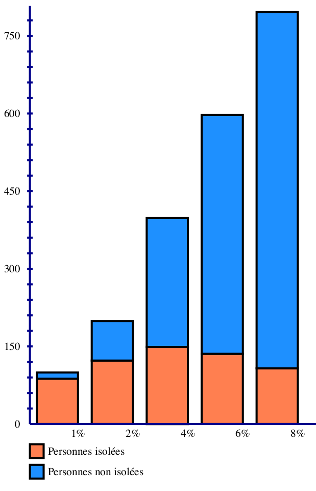

# Sujet n°6 : Diagrammes à barres et circulaires - réalisation contextuelle adaptée de diagrammes

*Encadrant :* Frédéric Serin

Le sujet vise à enrichir et homogénéiser les fonctionnalités graphiques. Il s'agit d'intégrer pleinement les diagrammes à barres et circulaires au sein de la structure actuelle en garantissant une rigueur formelle et ergonomique. Dans une démarche de conception universelle, le projet met l'accent sur l'accessibilité.

Le logiciel Latitude écrit en Java est un outil permettant, à partir de texte brut enrichi d'un balisage léger de générer des documents parfaitement lisibles et accessibles et pouvant comporter à la fois du texte, des tableaux, des diagrammes UML et des graphiques.

Latitude pour « Light and Accessible tags into plain text with Universal DEsign empowerment » a débuté sous forme de prototypes dès 2014 et sous forme exécutable et pratique à partir de 2018. Il n'a évidemment depuis cessé d'être augmenté et amélioré. Sur ces années, des parties du logiciel ont fait l'objet de communications scientifiques internationales et nationales.

Le résultat obtenu est à la fois léger en taille mais aussi en terme d'écriture du code HTML/SVG.

Huit couleurs sont proposées par défaut pour garantir les contrastes, trop souvent oubliés dans les logiciels grand public.

Dans la figure suivante, un exemple de diagramme à barres avec cumul.

Parmi les graphiques disponibles, les diagrammes à barre et circulaire (bar chart & pie chart) sont perfectibles.

En particulier, les diagrammes circulaires (camembert) ou semi-circulaire (hémicycles) ne sont pas encore intégrés à la structure actuelle et existent sous forme de classes distinctes. Il faudra donc homogénéiser le code et inclure ces diagrammes à la structure actuelle.

Latitude se veux un outil facile d'emploi pour tous et accessible à tous. Aussi, il doit être à la fois aisé de créer des diagrammes aussi bien pour des personnes sans trouble visuel que des personnes ayant une déficience visuelle, des troubles dyslexiques, daltonisme.

Dans la génération des diagrammes, la forme doit être claire et précise et le code doit permettre une parfaite compréhension via un lecteur d'écran.
