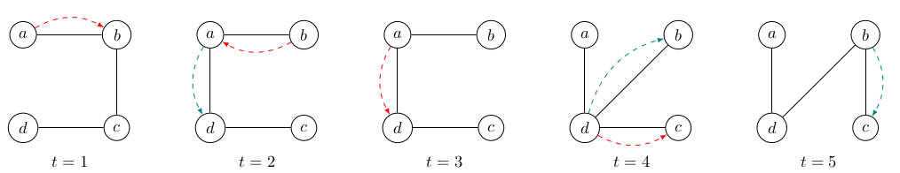

# Sujet n° 11 : Exploration de graphes temporels 1

*Encadrants :* Antoine Toullalan, Stefan Balev, Eric Sanlaville

## Contexte

Beaucoup de réseaux du monde réel ne sont pas statiques mais évoluent dans le temps. Par exemple, les connexions entre deux villes dans un réseau de transport dépendent des horaires du train, les liens dans un réseau social apparaissent et disparaissent, la connectivité entre les appareils dans un réseau sans fil varie selon leur mobilité ou la qualité du signal. Ces systèmes sont modélisés par des *graphes temporels*. Parmi les différentes définitions possibles, nous retenons la suivante : nous avons un ensemble fixe de sommets et du temps discret. À chaque pas de temps, une arête peut être présente ou pas.

Le problème d'*exploration* consiste à visiter tous les sommets en partant d'un sommet donné et en traversant au plus une arête par pas de temps. Ce problème a été largement étudié. On sait par exemple que si le graphe est connexe à chaque pas de temps, on peut toujours l'explorer en $`O(n^2)`$ pas de temps[^1]. On sait en plus qu'il existe des familles de graphes temporels qui nécessitent $`\Theta(n^2)`$ pas de temps pour être explorés.

Au sein de l'équipe RI2C du LITIS, nous nous intéressons à une variante peu étudiée du problème : étant donné suffisamment de temps, trouver l'exploration qui minimise le nombre d'arêtes traversées.

### Exemple

Dans le graphe temporel ci-dessus deux agents (rouge et bleu) partent du sommet $`a`$. Leurs déplacements sont indiqués par des flèches de couleur correspondant. L'agent rouge finit l'exploration plus tôt, mais son trajet est plus long que celui de l'agent bleu (quatre arêtes traversées pour le rouge contre trois pour le bleu). L'agent bleu reste sur place aux pas de temps 1 et 3.

## Objectif du projet

Le projet consiste à implémenter, comparer et analyser expérimentalement trois algorithmes d’exploration de graphes temporels.

1. Algorithme exact (recherche exhaustive)
    * Énumère toutes les possibilités afin de trouver l’exploration optimale (minimisant le nombre d’arêtes traversées).
    * Inapplicable pour de grandes instances à cause de sa complexité exponentielle.
    * Sert de référence pour évaluer la qualité des approches heuristiques.

2. Algorithme heuristique simple
    * Construit une exploration en reliant les sommets un par un à l’aide de chemins temporels.
    * Rapide, mais sans garantie théorique sur le nombre d’arêtes. Dans le pire cas, peut nécessiter $`O(n^2)`$ arêtes.

3. Algorithme avancé récent
    * Repose sur une approche plus sophistiquée (basée sur des résultats de recherche récents [^2]).
    * Garantie une exploration avec $O(n^{1.5})$ arêtes traversées.

## Travail attendu

1. Implémentation des algorithmes.
2. Génération d’instances de graphes temporels (aléatoires et structurées).
3. Comparaison expérimentale :
    * Temps de calcul,
    * Nombre d’arêtes traversées,
    * Évolutions selon la taille et la densité du graphe.
4. Rédaction d’un rapport présentant :
    * Les algorithmes et leurs principes,
    * Le protocole expérimental,
    * Les résultats obtenus (graphiques, tableaux),
    * Une analyse critique des performances et des limites.

## Références

[^1]: *On Temporal Graph Exploration*, Thomas Erlebach, Michael Hoffmann, Frank Kammer, https://doi.org/10.48550/arXiv.1504.07976

[^2]: *The shortest temporal exploration problem*, Stefan Balev, Éric Sanlaville, Antoine Toullalan, https://doi.org/10.1016/j.tcs.2026.116190
