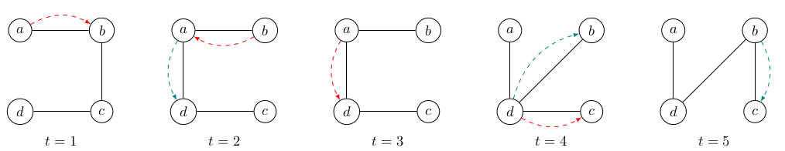

# Sujet n° 12 : Exploration de graphes temporels 2

*Encadrant :* Stefan Balev

## Contexte

Beaucoup de réseaux du monde réel ne sont pas statiques mais évoluent dans le temps. Par exemple, les connexions entre deux villes dans un réseau de transport dépendent des horaires du train, les liens dans un réseau social apparaissent et disparaissent, la connectivité entre les appareils dans un réseau sans fil varie selon leur mobilité ou la qualité du signal. Ces systèmes sont modélisés par des *graphes temporels*. Parmi les différentes définitions possibles, nous retenons la suivante : nous avons un ensemble fixe de sommets et du temps discret. À chaque pas de temps, une arête peut être présente ou pas.

Le problème d'*exploration* consiste à visiter tous les sommets en partant d'un sommet donné et en traversant au plus une arête par pas de temps. Ce problème a été largement étudié. On sait par exemple que si le graphe est connexe à chaque pas de temps, on peut toujours l'explorer en $`O(n^2)`$ pas de temps[^1]. On sait en plus qu'il existe des familles de graphes temporels qui nécessitent $`\Theta(n^2)`$ pas de temps pour être explorés.

Au sein de l'équipe RI2C du LITIS, nous nous intéressons à une variante peu étudiée du problème : étant donné suffisamment de temps, trouver l'exploration qui minimise le nombre d'arêtes traversées.

### Exemple

Dans le graphe temporel ci-dessus deux agents (rouge et bleu) partent du sommet $`a`$. Leurs déplacements sont indiqués par des flèches de couleur correspondant. L'agent rouge finit l'exploration plus tôt, mais son trajet est plus long que celui de l'agent bleu (quatre arêtes traversées pour le rouge contre trois pour le bleu). L'agent bleu reste sur place aux pas de temps 1 et 3.

## Objectif du projet

Dans un travail de recherche récent[^2], nous avons formulé la conjecture suivante : tout graphe temporel peut être exploré en $`n(n - 1)/2`$ pas de temps en utilisant au plus $`2n-3`$ traversées d'arêtes. L'objectif de ce projet est de vérifier expérimentalement cette conjecture pour des petits valeurs de $n$.

La vérification nécessite de générer *tous* les graphes temporels et pour chacun d'entre eux, *tous* les déplacements possibles de l'agent. Le code que nous avons développé s'exécute en temps raisonnable jusqu'à $`n = 5`$. Actuellement on ne peut pas aller plus loin à cause de l'explosion combinatoire.

Il est possible d'élaguer de façon drastique l'arbre de recherche en éliminant certains situations « dominées », mais au coût d'un temps de traitement très important pour chaque nœud. On peut espérer réduire ce temps en utilisant des structures de données astucieuses issues de la géométrie algorithmique.

## Travail attendu

1. Comprendre l'algorithme de recherche exhaustive mis en place.
2. Prendre en main le code existant. À cause des exigences de rapidité, on impose l'utilisation du langage **Rust**.
3. Implanter une première version naïve de l'élagage des nœuds.
4. Profiler le code et identifier les sections critiques qui prennent un temps important.
5. Proposer et tester des structures de données susceptibles d'améliorer les performances.
6. Rédaction d’un rapport présentant :
    * Les algorithmes, les structures de données et leurs principes,
    * Le protocole expérimental,
    * Les résultats obtenus (graphiques, tableaux),
    * Une analyse critique des performances et des limites.

## Références

[^1]: *On Temporal Graph Exploration*, Thomas Erlebach, Michael Hoffmann, Frank Kammer, https://doi.org/10.48550/arXiv.1504.07976

[^2]: *The shortest temporal exploration problem*, Stefan Balev, Éric Sanlaville, Antoine Toullalan, https://doi.org/10.1016/j.tcs.2026.116190
